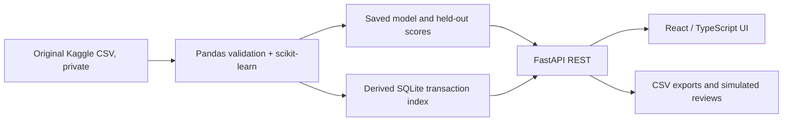

<div align="center">

# 🛡️ FraudShield
### Financial Fraud Detection & Risk Intelligence

**An end-to-end student research prototype that connects business analysis, SQL analytics, machine learning, and a usable fraud-investigation interface.**

`Python` · `Pandas` · `scikit-learn` · `FastAPI` · `SQLite / SQL` · `React` · `TypeScript` · `Vite`

**568,630 verified records** • **6 application views** • **2 model approaches** • **85,295 independent test records**

</div>

> **Portfolio disclaimer:** This is an educational prototype using an artificially balanced Kaggle dataset, not a live bank application. Predictions are not evidence of criminal activity, and simulated analyst decisions are not actual fraud investigations.

## The business problem
Fraud analysts need to prioritize suspicious transactions without overwhelming investigation teams with false positives. Reporting only *accuracy* hides the trade-off between missed fraud and false alarms. **FraudShield** lets a hypothetical operations team compare transaction patterns, review model-scored records, explore threshold-dependent decisions and understand data limitations.

## What you can explore
| Workspace | What actually works |
|---|---|
| **Executive dashboard** | Verified CSV statistics, risk-score deciles, threshold-based full-index alerts and model test scorecard |
| **Transaction explorer** | ID search, label / amount / risk filters, sorting, server-side pagination, CSV download, detail drawer |
| **Alert investigation** | Flag queue updated by threshold, simulated status and persisted local review notes |
| **Analytics & business insights** | SQL amount bands, class comparisons, Pearson feature correlations and global model importance |
| **Model decision lab** | Live held-out confusion matrix, precision / recall, ROC and PR curves, transparent hypothetical costs |
| **Data quality & documentation** | Seven validation checks, schema dictionary, methodology, requirements and important caveats |

### Working application screenshots
The code and precompiled UI are included; **the build environment could not open the browser because Chromium navigation was blocked by administrator policy**, so genuine screenshots will be captured after the application is verified on macOS. See `screenshots/README.md` for exact screenshot names. We deliberately do **not** include mock screenshots and claim they came from a running app.

## Verified findings (actual supplied CSV, 2026-11-18)
- **568,630 rows, 31 columns; 0 nulls; 0 duplicate IDs; 1 repeated feature vector (excluding ID)**.
- **284,315 legitimate / 284,315 fraud-labelled records** — exactly 50% / 50% by dataset construction, *not* an operational fraud prevalence.
- Class-mean recorded amounts: **12,026.31** (0) vs **12,057.60** (1); amount alone has weak separation.
- Most strongly correlated anonymous numerical features include **V14, V12, V4 and V11**. No claim is made about what these represent for a real customer.
- On **85,295 held-out test rows**, histogram gradient boosting reached **99.73% F1, 99.65% precision, 99.81% recall, 99.99% ROC-AUC** at threshold 0.50. **TP 42,565 · TN 42,499 · FP 149 · FN 82**. Logistic regression baseline F1 **96.41%**. Model chosen using validation PR-AUC only.

**These unusually strong results are specific to the curated/artificially balanced benchmark and must not be represented as generalizable real-world banking performance.** No dated trends, merchants or geography exist in the supplied CSV.

## Run locally (macOS + Visual Studio Code)

**You need:** Python **3.12 or 3.13** (recommended 3.13), VS Code, and an internet connection for the **first** Python dependency installation. Node.js is *not required* to run the prebuilt local demo. A Git installation is only needed when you decide to publish to GitHub later.

1. Unzip `FraudShield_Portfolio_Project.zip`, open the `FraudShield` folder in VS Code: **File → Open Folder**.
2. Open the VS Code integrated terminal (**Terminal → New Terminal**) and run:

```bash
python3 --version
python3 -m venv .venv
source .venv/bin/activate
python -m pip install -r backend/requirements.txt
python -m uvicorn backend.main:app --reload --host 127.0.0.1 --port 8000
```

3. Go to **http://127.0.0.1:8000** in Chrome or Safari. API reference: **http://127.0.0.1:8000/docs**. Click all six navigation items. The included scored-index DB and trained model make it usable immediately **without separately importing the 325 MB raw CSV**.
4. Press `Control+C` in the terminal to stop. Next time, from project root:

```bash
source .venv/bin/activate
python -m uvicorn backend.main:app --reload --host 127.0.0.1 --port 8000
```

**Optional one-command launch:** `bash scripts/run_mac.sh` handles venv/requirements/server. If `python3` points to Python 3.14 or older than 3.12, install Python 3.13 and explicitly use its executable to create `.venv`.

### Run tests

```bash
source .venv/bin/activate
python -m pip install -r backend/requirements-dev.txt
python -m pytest -q
```

Verified during packaging: **11 automated tests passed**. Browser/mobile tests require Mac sign-off; see `docs/TEST_PLAN.md`. To regenerate BI extracts: `python scripts/export_bi.py`.

### Modify the React UI with Vite (optional)
Install Node.js LTS if you want to edit frontend. Source is in `frontend/src/main.tsx` + `frontend/src/style.css`. The shipped browser build is in `frontend/dist` and needs **no npm install** to run.

```bash
cd frontend
npm install
npm run dev
```

With the Python API running on `127.0.0.1:8000`, Vite opens **http://127.0.0.1:5173** and proxies `/api` to FastAPI. After editing, `npm run build` refreshes `frontend/dist`, and the Python server serves the new build. This environment could not fetch npm dependencies, so Vite's npm build step was **not executed** here. The precompiled offline UI was generated and syntax-checked via TypeScript.

**UI implementation note:** A tiny vendored React/ReactDOM UMD runtime makes the local experience self-contained; hand-authored accessible SVG analytics charts and custom CSS replace external Recharts/Tailwind dependencies to avoid runtime network fetches. The optional Vite dev source remains TypeScript/JSX. See `frontend/public/vendor/README.md` for the runtime version and upgrade caution.

## Repository architecture


```text
FraudShield/
├── backend/           FastAPI endpoint implementation + Python requirements
├── frontend/          React + TSX + Vite source; precompiled offline dist/
├── database/          SQLite schema, tested local derived index, SQL queries, optional PG design
├── analytics/         Generated metrics + EDA Jupyter notebook
├── models/            Selected model and independent held-out prediction scores
├── bi/                Derived Power BI / Tableau-compatible summary CSVs
├── docs/              BRD, architecture, testing/UAT, release, BI, interview, user guide
├── scripts/           Reproducible training + analytic exports + launch helpers
├── screenshots/       Genuine screenshot checklist (capture after Mac verification)
├── tests/             Backend API tests
└── README.md
```

## Reproduce analysis from the original dataset
1. Download the **actual 2023 CSV** from [Kaggle — Credit Card Fraud Detection Dataset 2023](https://www.kaggle.com/datasets/nelgiriyewithana/credit-card-fraud-detection-dataset-2023) or use your separately provided dataset ZIP.
2. Extract it to `data/creditcard_2023.csv` and never stage or commit the raw file.
3. Run `python scripts/build_data.py --csv data/creditcard_2023.csv` from project root. This rebuilds **the model, evaluations, JSON insights and derived SQLite**. *It overwrites saved simulated analyst reviews.*
4. Open `analytics/fraudshield_eda.ipynb` for EDA source and commentary. Run `python scripts/export_bi.py` for genuine BI data extracts.

Model features: `V1…V28` + `Amount`; `id` and `Class` excluded from predictors. One identical feature vector excluded from splitting; validation selects the winner; test remains held out. See [Data Science Methodology](docs/METHODOLOGY.md) and [Architecture](docs/ARCHITECTURE.md).

### Dataset rights and GitHub protection
The uploaded raw CSV is **not** inside this project ZIP. The ZIP contains an educational **derived** SQLite scored record index for an immediately runnable local demo, but `database/*.sqlite` and `data/*.csv` are configured to be **ignored by Git**. Review the Kaggle dataset's current license and redistribution terms before sharing row-level derivatives. In a GitHub-only clone without the private SQLite index, download the original source and rerun the pipeline. Project source license is in `LICENSE`; upstream React runtime is third-party MIT.

Data source: Nidula Elgiriyewithana, *Credit Card Fraud Detection Dataset 2023*, Kaggle (2023), https://doi.org/10.34740/KAGGLE/DSV/6492730. The name does not prove that individual records occurred in 2023. The exact synthetic generation provenance could not be verified.

## Business systems analysis & testing
- [Business requirements, stakeholders, AS-IS/TO-BE, RTM](docs/BRD.md)
- [System, ER diagram, SQL trace, API architecture](docs/ARCHITECTURE.md)
- [Data validation, model comparison, source limitations](docs/METHODOLOGY.md)
- [Executed automated test summary and **unexecuted** UAT cases](docs/TEST_PLAN.md)
- [Power BI / Tableau CSV exports and DAX definitions](docs/BI_GUIDE.md)
- [Release notes and known limitations](docs/RELEASE_NOTES.md)
- [60-second recruiter pitch and verified resume bullets](docs/INTERVIEW_GUIDE.md)
- [User guide](docs/USER_GUIDE.md)

## Next improvements
Cross-version browser verification; modernize vendored React; add authentication and named case ownership; production PostgreSQL migration; external naturally imbalanced, dated test data; calibration and drift monitoring; real human audit requirements; dashboard screenshots and deployment documentation after the Mac walkthrough.

---
**Student-built portfolio system · not a production fraud-detection service.**
