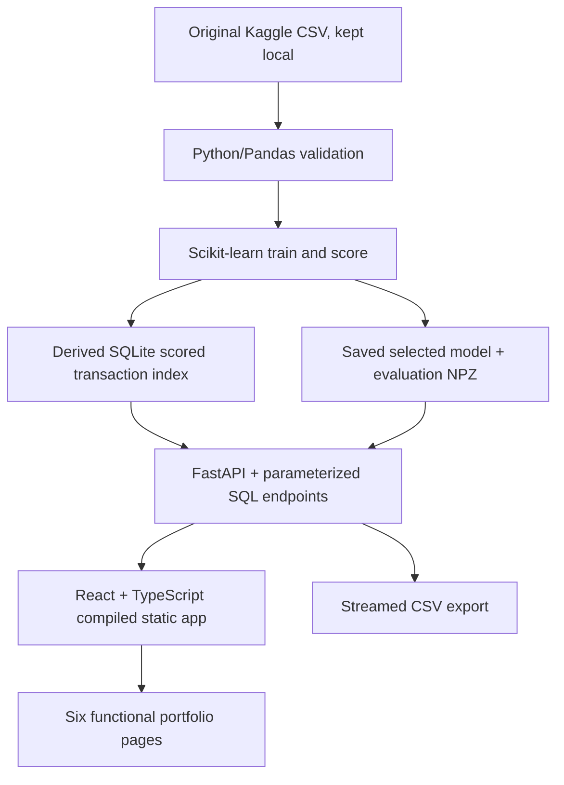
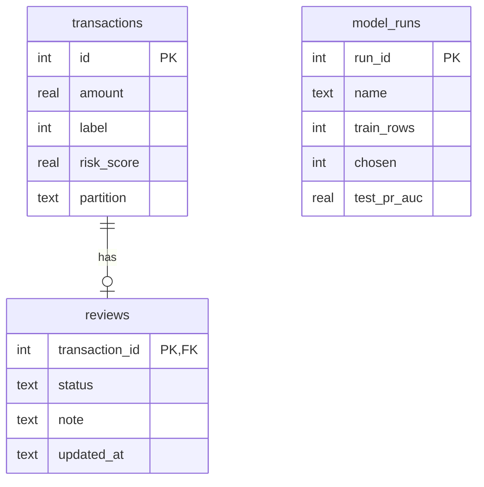

# Architecture, SQL & integration design

## Architecture

**Local process:** `python -m uvicorn backend.main:app --reload` serves the FastAPI JSON endpoints and versioned `frontend/dist` prebuild on port 8000. No real bank connectors. Vite is supplied for frontend development but isn't required for first-run demo.

## ER diagram

`model_runs` records selected experiment metadata, not a forged per-transaction relationship. The prototype has a single active scored model. `reviews` has a true FK to transaction IDs; its values are **simulated investigator actions**.

## Data flow and storage decisions
- Source dataset contains id + anonymized V1–V28 + Amount + Class, and remains excluded from packaged project sources and Git via `.gitignore`.
- Derived educational `fraudshield.sqlite` contains id, amount, supplied class label, selected-model risk score and partition. It intentionally **does not retain full original V feature vectors**.
- Threshold-independent held-out model probabilities are in `models/heldout_scores.npz`; `GET /api/decision` recomputes TP/TN/FP/FN, precision, recall and scenario cost for each threshold request. This avoids falsified curves.
- Saved scikit-learn selected model is in `models/selected_model.joblib`, and `POST /api/predict` accepts a complete V1–V28 + amount vector, validated with Pydantic. Pickle/joblib artifacts must be loaded only from trusted sources.
- `analytics/summary.json` captures checks and the reference experiment. JSON numbers are **generated by** `scripts/build_data.py`.
- Do not put `fraudshield.sqlite` on a public GitHub repository until per-row derivative redistribution rights are reviewed. The supplied ZIP uses it for turnkey offline demonstration; source CSV is not included.

## REST API contract
| Route | Purpose |
|---|---|
| GET `/api/health` | Startup checks |
| GET `/api/overview?threshold=0.5` | Dataset KPI, full-index alerts, score bins |
| GET `/api/insights` | SQL-derived amount bands and model feature associations |
| GET `/api/models` | Baseline / alternative test scores and ROC/PR curves |
| GET `/api/decision?threshold=.5&prevalence=.01...` | Held-out confusion matrix and scenario |
| GET `/api/quality` | Audit and field dictionary |
| GET `/api/transactions?sort=risk_score&page=1...` | Filtered 12-row page |
| GET `/api/transactions/export?...` | Stream CSV matching current filter set |
| GET `/api/transactions/{id}` | Record details and model interpretation limits |
| PUT `/api/reviews/{id}` | Simulated status and local note persistence |
| POST `/api/predict` | Single prediction from 29 numeric features |
| GET `/docs` | FastAPI-generated OpenAPI interface |

## SQL coverage
Open `database/queries.sql` for executable: JOIN, primary/foreign keys, CTE, CASE, GROUP BY, HAVING, validation query, subqueries, view and window functions. Executive amount-band queries also run directly within `/api/insights` rather than exist solely in a lecture file. `database/postgresql_optional.sql` is an optional PostgreSQL version of the normalized core design, **not a tested deployment**. SQLite remains the tested local database.

## Privacy / security / reliability
No credentials or customer details. API fields are bounded and SQL filters are bound parameters; sort keys are strict enum whitelist. Export and notes are local. Model and file loading assume trusted local files. No authentication, authorization, rate limiting, fraud confirmation, logging retention, case ownership or live deployment hardening is provided; add these before any actual use. Browser does not load all 568k records at once. The React runtime is vendored for offline execution; see vendor licensing and compatibility notes.
