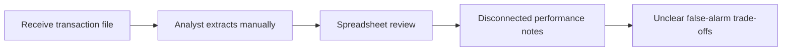
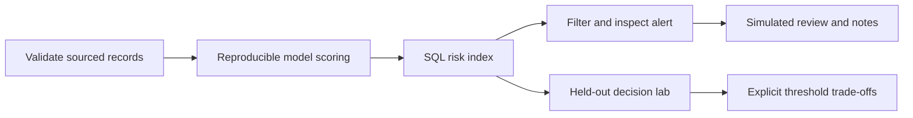

# FraudShield — Business Requirements Document (BRD)
**Version:** 1.0 · **Date:** 2026-11-18 · **Status:** Implemented student prototype

## Project charter and problem statement
**Sponsor:** simulated bank Fraud Operations leadership. **Project owner:** student developer. **Objective:** reduce the disconnect between transactional reporting, model outcomes, and manual investigation by providing one explainable exploratory dashboard. This is a **hypothetical business case**, not a commissioned system. No stakeholder interviews or approvals took place.

**Decision problem:** fraud investigators must trade off the cost of missed fraud against false alarms and operational workload. A manager needs threshold-sensitive metrics and explicit assumptions rather than a single misleading accuracy figure.

**Scope:** analyze Kaggle's `creditcard_2023.csv`, compare supervised models, expose searchable scored records, allow local simulated reviews, and document data quality, decisions, and limits. **Out of scope:** bank integration, actual fraud adjudication, merchant segmentation, real customer records, historical monitoring and automated enforcement.

## Simulated stakeholders
| Stakeholder (simulated) | Problem and information need | Application response |
|---|---|---|
| Fraud Operations Manager | Review volume and missed cases | Dashboard + decision lab threshold |
| Fraud Investigation Analyst | Prioritize cases and record investigation | Alert queue + notes/status |
| Risk Management Analyst | False alarm vs. missed fraud trade-off | Held-out confusion matrix + cost scenarios |
| Data Analyst | Explore class patterns and data quality | Insights + quality pages + SQL |
| Business Systems Analyst | Trace requirements to acceptance criteria | BRD + RTM + test plan |
| IT / Data Engineer | Reproducible imports and auditable APIs | Pipeline + typed FastAPI + SQL schema |
| Compliance & Audit | Inspect provenance and limitations | Documentation + persisted reviews |

These personas describe **simulated requirements elicitation**, not interviews.

## Business requirements and measures
| ID | Requirement | Priority | Verification |
|---|---|---|---|
| BR-01 | Display verified source size and class balance | Must | Dashboard / API test |
| BR-02 | Make records searchable without loading 568k in browser | Must | Paginated SQL API / tests |
| BR-03 | Show known labels separately from risk predictions | Must | Explorer labels + detail pane |
| BR-04 | Let analyst prioritize and document flagged records | Must | Alerts + local review persistence |
| BR-05 | Show independent model comparison and threshold trade-offs | Must | Test-only evaluation / decision page |
| BR-06 | Provide accurate amount-band and numeric-feature insights | Must | Analytics page / SQL queries |
| BR-07 | Publish data lineage and quality checks | Must | Data & documentation page |
| BR-08 | Reproduce the model and dashboard from sourced data | Must | Training script / install guide |
| BR-09 | Allow filtered CSV export | Should | Export endpoint / test |
| BR-10 | Present cost impact with labeled assumptions, not invented savings | Must | Decision lab / acceptance test |

## Functional requirements
FR-01 GET overview metrics from the scored index; FR-02 GET filtered, paginated transactions; FR-03 GET single transaction; FR-04 GET filtered CSV as stream; FR-05 GET model curves, metrics and independent threshold results; FR-06 GET assumed cost scenarios; FR-07 PUT persisted simulated status/note; FR-08 POST single-record prediction using 29 explicitly ordered numeric features; FR-09 GET quality checks, method and documentation; FR-10 show responsive navigation for six pages.

## Non-functional requirements
NFR-01 Local-first setup with no secret API keys; NFR-02 SQL parameterization and Pydantic bounds validation; NFR-03 no source raw CSV or customer information bundled as source code; NFR-04 clear loading and error states; NFR-05 keyboard-accessible buttons and tables; NFR-06 reproducible fixed seed = 42; NFR-07 avoid unmeasured performance promises; NFR-08 reflect dataset's inability to support timestamp, merchant or customer reporting.

## User stories & acceptance criteria
**US-01 — Fraud Analyst:** As an analyst, I want high-scoring transactions so I can prioritize simulated reviews. **Given** a threshold of 0.80, **when** I open Alerts, **then** only `risk_score >= 0.80` records appear, in descending score order; review states persist after refresh.

**US-02 — Risk Manager:** As a risk manager, I need to adjust thresholds and distinguish missed fraud from false alarms. **Given** a held-out test set, **when** the threshold is raised, **then** the displayed confusion matrix and detection rate are recomputed from saved test predictions (not fabricated).

**US-03 — Data Analyst:** As a data analyst, I need to explain which segments differ. **Given** the source records, **when** I open Analytics, **then** amount-band totals reconcile to 568,630, correlations use actual numerical columns, and no dates or merchant claims are shown.

**US-04 — BA / auditor:** As an auditor, I need traceable outcomes. **Given** the model and data pipeline, **when** I open Data & Docs, **then** I see null/duplicate checks, feature definition and train/validation/test method with methodological caveats.

**US-05 — Reviewer:** As a stakeholder, I need a shareable filtered extract. **Given** selected search filters, **when** I export CSV, **then** it includes only matching rows and correct source-column distinction.

## Requirements traceability matrix (RTM)
| BR | FR | Implementation | Test evidence |
|---|---|---|---|
| BR-01 | FR-01 | `/api/overview`, Overview | `test_overview_and_insights` |
| BR-02 | FR-02 | SQL WHERE / ORDER / LIMIT, Explorer | `test_pagination_search_filter_sort` |
| BR-03 | FR-03 | Known-label and risk-score detail | `test_transaction_detail_and_review_persistence` |
| BR-04 | FR-07 | `reviews` table + PUT, Alerts | `test_transaction_detail_and_review_persistence` |
| BR-05 | FR-05 | Held-out `.npz`, Decision lab | `test_threshold_changes` |
| BR-06 | FR-01/09 | `/api/insights`, Analytics | `test_overview_and_insights` |
| BR-07 | FR-09 | `/api/quality`, Data & Docs | `test_quality_and_models` |
| BR-08 | FR-08 | `scripts/build_data.py`, model artifact | `test_model_inference_and_feature_validation` |
| BR-09 | FR-04 | CSV streaming export | `test_export_matches_filters` |
| BR-10 | FR-06 | Hypothetical simulation in API | `test_threshold_changes` (partial) |

## AS-IS vs. TO-BE: simulated processes

**Change hypothesis:** greater consistency and visibility for a simulated operations team. There are **no observed business efficiency or savings outcomes** in this project.

## Release criteria
- Dataset schema, splits, and metrics reproducible.
- Functional API, filters, exports and simulated review persistence verified by tests.
- Developer README and limitations provided.
- Actual user acceptance sign-off and live deployment **not performed**.
